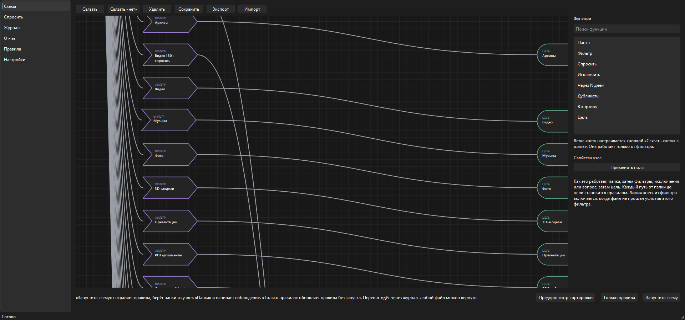
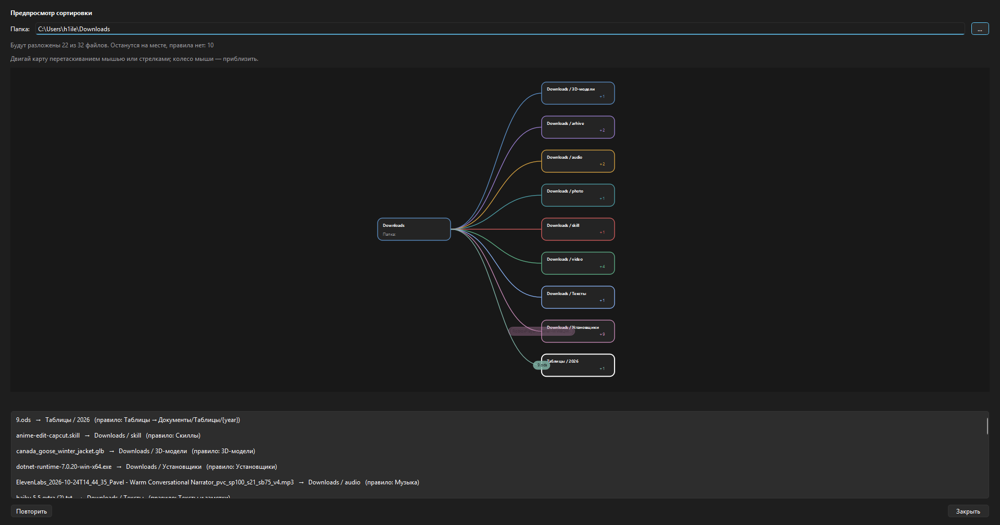

# AutoUtil

**🇷🇺 Русский** | [🇬🇧 English](README_EN.md)

Автосортировка файлов для Windows. Следит за выбранными папками (Загрузки, Рабочий стол и т.д.) и раскладывает файлы по правилам: документы — в «Документы», скриншоты постарше — в корзину, чеки — по папкам с OCR-распознаванием текста. Каждый перенос записывается в журнал и может быть отменён одним кликом.

> **AutoUtil** keeps your folders tidy: it watches your folders and sorts new files by rules you draw as a simple scheme. Every move is logged and can be undone. Windows 10/11, fully offline.




---

## Возможности

- **Схема на экране** — рисуешь линиями: *Папка → Фильтр → Цель/Корзина*. Запускается одной кнопкой, работает как обычные правила.
- **Гибкие правила** — по расширению, ключевым словам (включая текст из PDF и распознанный текст с картинок), маске/регулярке имени, размеру, возрасту, GPS-тегу фото.
- **Узел «Дубликаты»** — чистит копии файлов и всегда оставляет одну. По маске (например `robloxinstaller*` + расширение `exe`) или авто-режимом с пустыми полями: узел сам находит дубликаты по похожему имени («(1)», «копия», «download»), одному размеру и одному хешу SHA-256. Убранное лежит в корзине и в журнале — можно вернуть.
- **Предпросмотр сортировки** — окно на весь экран: до переноса видишь, куда «полетят» файлы из папки, по анимированной схеме. Двигать карту мышью или стрелками, приближать колесом.
- **Журнал с откатом** — каждый перенос записывается в журнал; любой файл можно вернуть на место. Журнал append-only и ротируется при 10 МБ (хранятся 3 копии).
- **Предпросмотр правила** — на странице «Правила»: выбери папку и правило, увидишь, какие файлы под него попадут и куда уйдут — до реального переноса.
- **Отложенные действия** — «убрать в корзину через N дней»: файл лежит на месте, напоминание придёт в срок.
- **Режимы работы** — Активен / Пауза / Не беспокоить (иконка в трее). В паузе уведомления копятся. Файлы, пришедшие в паузу, разбираются сами при возврате в активный режим. Залоченные или ещё записывающиеся файлы не пропадают: очередь повторов проверяет их каждые 30 секунд, пока не отсортирует.
- **Только план (dry-run)** — режим «понажимать и посмотреть»: файлы не переносятся, приходят только уведомления с планом. Включается в «Настройках», применяется сразу.
- **Очистка кэша приложений** — раз в 30 дней чистит известные кэши (браузеры, IDE и т.д.), защищённые папки не трогает.
- **Обучение** — если ты вручную переназначил, куда уходит файл такого типа, AutoUtil запомнит и спросит подтверждение.
- **Два языка** — русский и английский, выбирается при первом запуске, меняется в настройках.

Всё работает локально: распознавание текста (RapidOCR) и PDF — офлайн, данные никуда не отправляются.

## Быстрый старт

### Готовый exe

Возьми `dist/AutoUtil.exe` из релиза, запусти. Мастер первого запуска спросит язык и поможет собрать первую схему.

### Из исходников

Нужен Python **3.12+**.

```powershell
git clone <repo>
cd AutoUtil
powershell -ExecutionPolicy Bypass -File build.ps1
```

Скрипт сам создаст `.venv`, поставит зависимости, прогонит тесты и соберёт `dist/AutoUtil.exe`.

Для запуска без сборки:

```powershell
py -3.12 -m venv .venv
.venv\Scripts\python.exe -m pip install -e ".[dev]"
.venv\Scripts\python.exe main.py
```

## Как пользоваться

1. **Схема** — добавь узел «Папка» (например, `C:\Users\you\Downloads`), от него линию к «Фильтру» (расширения, ключевые слова...), от фильтра — к «Цели» (например, `Документы/PDF/{year}`) или «Корзине». Жми «Запустить схему». Хочешь почистить однотипные копии (инсталляторы, `game (1).exe`) — добавь узел «Дубликаты» с маской или вовсе без неё.
2. **Предпросмотр сортировки** — кнопка в футере страницы «Схема»: покажет анимированную схему, куда уйдут файлы папки.
3. **Правила** — тот же список правил текстом: включай/выключай галочками, наводи порядок. Кнопка «Предпросмотр» покажет, кого правило зацепит в выбранной папке.
4. **Отложенные** — файлы, ждущие срока «убрать через N дней». Можно выполнить сейчас или вернуть.
5. **Журнал** — история переносов. Выдели запись — «Вернуть файл», и файл вернётся на исходное место (мешающий файл при этом аккуратно убирается в сторону, не удаляется).
6. **Настройки** — тема, размер шрифта, автозапуск с Windows, режим «только план».

## Где хранятся данные

Всё в `%LOCALAPPDATA%\AutoUtil\`:

| Файл | Что это |
|---|---|
| `schema.json` | визуальная схема |
| `rules.json` | правила сортировки |
| `settings.toml` | настройки |
| `journal.jsonl` | журнал переносов (+ до 3 ротационных копий) |
| `learned.json` | выученные переназначения |
| `logs\autoutil.log` | журнал приложения (1 МБ × 3) |

Безопасность: пути назначения ограничены домашней папкой пользователя — импортированная чужая схема физически не сможет отправить файлы на другой диск или в системные папки (проверяется при импорте).

## Тесты

```powershell
.venv\Scripts\python.exe -m pytest -q
```

Покрыты: сопоставление правил, планировщик, безопасность путей, перенос файлов (включая гонки и занятые цели), журнал (откаты, битые строки, ротация), именование, наблюдатель (дедупликация событий), очередь повторов и буфер паузы, узел «Дубликаты», стресс-матрица конвейера (24 файла × 12 правил), очистка кэша, предпросмотры правила и схемы, покрытие переводов. Сейчас — 103 теста.

## Структура проекта

```
main.py                  запуск: мьютекс, язык, мастер, трей, сервис
core/                    журнал, i18n, события, состояние, отложенные
modules/organizer/       анализ файлов, правила, планировщик, OCR, кэш
ui/                      PySide6: схема, правила, журнал, отчёты, трей
win/                     Windows-специфика: пути, тосты, автозапуск, DPI
tests/                   pytest-комплект
build.ps1                сборка exe (PyInstaller --onefile --windowed)
```
